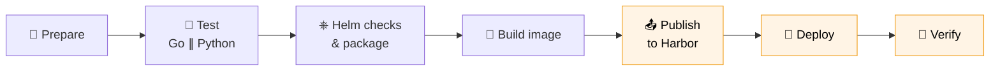

# 🚀 HPA+ Jenkins Pipeline

> Test, build, publish and deploy the **HPA+ operator** to Kubernetes with a single Jenkins job.

[`Jenkinsfile`](Jenkinsfile) tests the operator and builds its container image. It packages the Helm chart in [`helm/`](../helm) and publishes the image and the chart to the COP-PILOT **Harbor** registry. It then deploys the operator to the **staging cluster** the same way as the main [README](../README.md#build-and-install) and the [installation guide](../docs/user-guide/installation.md).

---

## 📑 Contents

- [⚡ Quick start](#-quick-start)
- [🔄 Pipeline at a glance](#-pipeline-at-a-glance)
- [📖 How it relates to the README instructions](#-how-it-relates-to-the-readme-instructions)
- [🧱 Stages](#-stages)
- [📦 Where things are published](#-where-things-are-published)
- [✅ Requirements](#-requirements)
- [🔐 Private Harbor](#-private-harbor)
- [🎛️ Parameters](#️-parameters)
- [🛠️ Installing by hand](#️-installing-by-hand)
- [📝 Notes](#-notes)

---

## ⚡ Quick start

1. 🔑 Make sure these Jenkins credentials exist: `harbor-creds` (username with password) and `staging-kubeconfig` (secret file).
2. 🆕 Create a **Pipeline** or **Multibranch Pipeline** job that points to this repository.
3. 📄 Set **Script Path** to `jenkins/Jenkinsfile`.
4. ▶️ Click **Build with Parameters**.

> [!NOTE]
> Jenkins registers declarative parameters on the first run, and that run uses the defaults.

---

## 🔄 Pipeline at a glance



🟧 The highlighted stages run only when `DEPLOY=true` **and** the build is not a pull request. Pull requests are tested, linted, packaged and built, but nothing is published or deployed.

---

## 📖 How it relates to the README instructions

The main README installs the operator in three steps. The pipeline runs the same steps with Harbor as the registry and adds safety checks around them:

| # | README step | What it does | Pipeline stage |
| :-: | --- | --- | --- |
| 1️⃣ | `make docker` | Builds the operator image | 🐳 Build image |
| 2️⃣ | `make push` | Pushes the image to a registry | 📤 Publish to Harbor |
| 3️⃣ | `helm upgrade --install … ./helm` | Installs the chart, pointing it at that image | 🚢 Deploy |

> [!TIP]
> Nobody pulls the image by hand. Helm creates the Deployment, and the **cluster nodes pull the image** from Harbor when the operator pod starts. Because Harbor is private, the pipeline gives the nodes a pull Secret. See [🔐 Private Harbor](#-private-harbor).

---

## 🧱 Stages

| Stage | What happens |
| --- | --- |
| 🧭 **Prepare** | Builds the image and chart references and the chart version from `helm/Chart.yaml` and the commit SHA. Fails early if `HELM_VALUES_FILE` points to a missing file. |
| 🧪 **Test** | Runs two jobs in parallel in throwaway `docker run` containers that mount the workspace and run as the Jenkins user.<br/>🐹 **Go:** `go vet ./...` and `go test ./...` in the same `golang` image as the Dockerfile.<br/>🐍 **Python:** installs the hash-pinned `algorithms/requirements.txt` into a venv, runs `pytest` and publishes JUnit reports.<br/>Skip with `RUN_TESTS=false`. |
| ⎈ **Helm checks & package** | Runs `helm lint` and `helm template` with the Harbor image, then `helm package` with the CI chart version. Archives `rendered-manifests.yaml` and the chart `.tgz` with the build. |
| 🐳 **Build image** | `docker build --platform linux/amd64` from the repository `Dockerfile`. |
| 📤 **Publish to Harbor** | Logs in with `harbor-creds`, then pushes the image with `docker push` and the chart with `helm push`. |
| 🚢 **Deploy** | Creates `NAMESPACE` if needed and creates or updates the `harbor-creds` pull Secret. Then runs `helm upgrade --install <release> ./helm` with the Harbor image and `imagePullSecrets[0]=harbor-creds`, and waits up to **10 minutes**. Installs or updates the `hpapluses.hpa.plus` CRD, the operator Deployment and its RBAC. |
| 🔎 **Verify** | Waits for `deployment/hpa-plus-operator` to roll out, checks the CRD, prints the deployed image and shows `helm status`. |

**🩺 When something fails:** if a deployment was attempted, the pipeline prints the operator pods, the Deployment description, the last 200 log lines and recent namespace events.

**🧹 Always:** the pipeline logs out of Harbor, deletes the build's registry login files and removes the local image from the agent. Logins are stored in the build workspace (`DOCKER_CONFIG`, `HELM_REGISTRY_CONFIG`), never in the agent user's home directory.

---

## 📦 Where things are published

| Artifact | Harbor location |
| --- | --- |
| 🐳 Operator image | `harbor.cop-pilot.rid-intrasoft.eu/hpa-plus/hpa-plus-operator:<commit-sha>` |
| ⎈ Helm chart (OCI) | `oci://harbor.cop-pilot.rid-intrasoft.eu/hpa-plus/charts/hpa-plus-operator`<br/>version `<chart-version>-g<commit-sha>` |

🏷️ Both are tagged with the **12-character commit SHA**, so every image and chart in Harbor maps to exactly one commit. For example:

| `helm/Chart.yaml` version | Commit | Chart version | Chart `appVersion` | Image tag |
| --- | --- | --- | --- | --- |
| `0.14.0-hpaplus` | `24019fb5de6c` | `0.14.0-hpaplus-g24019fb5de6c` | `24019fb5de6c` | `24019fb5de6c` |

The `g` prefix keeps the version valid SemVer when the SHA contains only digits.

⚙️ The registry settings are fixed in the `environment` block of the Jenkinsfile:

```groovy
DOCKER_REG       = 'harbor.cop-pilot.rid-intrasoft.eu'
DOCKER_REG_CREDS = 'harbor-creds'
DOCKER_REPO      = '/hpa-plus/'
```

---

## ✅ Requirements

### 🧩 Jenkins plugins

- ✔️ Pipeline (declarative), plus Pipeline: Multibranch for multibranch jobs
- ✔️ Credentials Binding
- ✔️ JUnit
- ✔️ Timestamper

### 🖥️ Agent

The agent selected by `AGENT_LABEL` (default `cop-pilot-staging-cluster`) needs:

- 🐳 **Docker**, usable by the Jenkins user (for example in the `docker` group), able to build `linux/amd64` images and to bind-mount the build workspace into containers
- ⎈ **helm 3.8+** (for OCI `helm push`) and ☸️ **kubectl** on the `PATH`
- 🌐 Network access to Docker Hub (base images), `harbor.cop-pilot.rid-intrasoft.eu` and the cluster API server

### 🔑 Credentials

| ID | Kind | Used for |
| --- | --- | --- |
| `harbor-creds` | 👤 Username with password | Pushing the image and chart to Harbor, and building the pull Secret the cluster uses to pull the image. A Harbor robot account with **push and pull** access to the `hpa-plus` project is recommended. |
| `staging-kubeconfig` | 📄 Secret file | kubeconfig for the staging cluster. Change it with `KUBECONFIG_CREDENTIALS_ID`. |

> [!IMPORTANT]
> The kubeconfig identity needs **cluster-admin** rights, because the chart manages the CRD and cluster-wide RBAC.

### ☸️ Cluster

Same as the main README: Kubernetes **1.23+**, a working resource metrics API such as **metrics-server**, and **amd64 Linux** nodes (the chart's default node selector requires them).

---

## 🔐 Private Harbor

The Harbor `hpa-plus` project is private, so the cluster needs credentials to pull the operator image. The pipeline handles this on every deployment:

1. 🔏 **Creates the pull Secret:** it builds a `kubernetes.io/dockerconfigjson` Secret named `harbor-creds` in `NAMESPACE` from the `harbor-creds` Jenkins credential, and applies it with `kubectl apply`. A rotated password is picked up on the next run.
2. 🔗 **Attaches it to the pods:** it installs the chart with `--set 'imagePullSecrets[0]=harbor-creds'`. The chart adds the Secret to the operator Deployment and, when enabled, to the cgroup collector DaemonSet.

> [!NOTE]
> 🛡️ The password is written to a file only the build user can read, never passed on a command line, and deleted right after use.
>
> `imagePullSecrets` is a chart value added for this purpose. Its default `[]` renders nothing, so installs that don't use it are unchanged.

---

## 🎛️ Parameters

| Parameter | Default | Description |
| --- | --- | --- |
| 🏷️ `AGENT_LABEL` | `cop-pilot-staging-cluster` | Agent label. Empty means any agent. |
| 🔑 `KUBECONFIG_CREDENTIALS_ID` | `staging-kubeconfig` | kubeconfig credential ID. |
| ☸️ `KUBE_CONTEXT` | *(empty)* | kubeconfig context. Empty uses the file's current context. |
| 📁 `NAMESPACE` | `hpa-plus-system` | Namespace for the operator. |
| ⎈ `RELEASE_NAME` | `hpa-plus-operator` | Helm release name. |
| 🔢 `TARGET_KUBE_VERSION` | `1.30.0` | Kubernetes version assumed by the offline `helm lint`/`helm template` checks. Set it to your cluster's version (1.23+). |
| 📝 `HELM_VALUES_FILE` | *(empty)* | Optional values file, relative to the repository root, applied on top of the chart values at deploy time. |
| 🧪 `RUN_TESTS` | `true` | Run the Go and Python tests. |
| 🚢 `DEPLOY` | `true` | Publish to Harbor and deploy. With `false`, the pipeline stops after the image build and Helm checks. |

> [!TIP]
> 🧰 **Environment-specific settings**, such as `cgroupCollector.enabled`, `networkPolicy`, `workerIsolation` or `resources`, go in a committed values file passed through `HELM_VALUES_FILE`. Keep secrets out of it. The pipeline always sets the image repository and tag, overriding the values file. See the [configuration reference](../docs/reference/configuration.md).

---

## 🛠️ Installing by hand

<details>
<summary>👉 Click to see the commands the Deploy stage runs</summary>

<br/>

For a commit whose image is already in Harbor:

```bash
# 1. Namespace and pull Secret
kubectl create namespace hpa-plus-system --dry-run=client -o yaml | kubectl apply -f -
kubectl -n hpa-plus-system create secret docker-registry harbor-creds \
  --docker-server=harbor.cop-pilot.rid-intrasoft.eu \
  --docker-username=<harbor-user> --docker-password=<harbor-password> \
  --dry-run=client -o yaml | kubectl apply -f -

# 2. Install the operator
helm upgrade --install hpa-plus-operator ./helm \
  --namespace hpa-plus-system --create-namespace \
  --set image.repository=harbor.cop-pilot.rid-intrasoft.eu/hpa-plus/hpa-plus-operator \
  --set image.tag=<commit-sha> \
  --set 'imagePullSecrets[0]=harbor-creds'
```

📦 **From the Harbor chart instead of `./helm`:** run `helm registry login harbor.cop-pilot.rid-intrasoft.eu`, then use this as the chart:

```bash
oci://harbor.cop-pilot.rid-intrasoft.eu/hpa-plus/charts/hpa-plus-operator --version <chart-version>-g<commit-sha>
```

`--set image.repository` is still required, because the chart's default `values.yaml` points to the upstream image repository.

</details>

---

## 📝 Notes

> [!WARNING]
> ⏸️ **Upgrades pause autoscaling briefly.** The chart's default `deploymentStrategy: Recreate` stops the old operator before starting the new one. Workloads keep running, but autoscaling pauses for a short time during each deployment.

- ↩️ **Rollback:** the pipeline does not roll back automatically. Use `helm rollback <release> -n <namespace>`, or install an earlier chart version from Harbor ([🛠️ Installing by hand](#️-installing-by-hand)). The image and the CRD should come from the same commit. Rolling back the image does not revert a CRD change, so check this before rolling back across one.
- ☝️ **One autoscaler per workload:** the pipeline deploys only the operator and creates no `HPAPlus` resources. See [getting started](../docs/user-guide/getting-started.md) and start new configurations in `observe` mode.
- 🚦 **No overlapping deployments:** builds of the same job never run concurrently.
- 🔧 **Toolchain versions:** the test images (`golang:1.27.1`, `python:3.14.7`) match the Dockerfile. When you bump Go or Python there, update the `Jenkinsfile` too.
